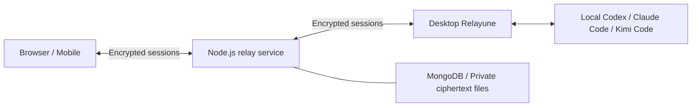

<p align="center">
  
</p>

# Relayune

**Pick up your computer's AI coding tasks from anywhere.**

Use your phone, tablet or browser to follow Codex, Claude Code and Kimi Code, continue conversations,
and respond to approvals. Agents execute in the original projects on your computer; Relayune connects
clients and routes encrypted sessions.

[Website & downloads](https://relayune.giraffetree.cn/#downloads) · [Get started](#get-started) ·
[Self-hosting](#self-hosting) · [Documentation](docs/README.md) · [简体中文](README.md)

[](https://github.com/giraffe-tree/Relayune/actions/workflows/quality.yml)
[](LICENSE)

## What you can do

- **Resume ongoing work**: browse projects, session history and live output; send messages, steer or stop tasks where the Agent supports it.
- **Make decisions on your phone**: read the context of commands, file operations and questions before allowing, rejecting or answering.
- **Connect multiple computers**: switch between computers and projects while keeping each computer's working directories and Agent environment.
- **Authorize clients independently**: pair with an eight-character code or QR scan; each client has its own content key and can be revoked separately.
- **Choose your server**: use the official service or deploy the same Node.js + MongoDB backend and configure its address in your clients.

The primary integrations are **Codex, Claude Code and Kimi Code**. Other adapters and their experimental
status are documented in the [documentation index](docs/README.md). Each Agent uses your own account
and model access; your Relayune account connects devices.

## Get started

### Install

| Device | Availability |
| --- | --- |
| macOS 13+ | [Download](https://relayune.giraffetree.cn/#downloads) the signed and Apple-notarized Universal package for Apple silicon and Intel |
| Android | [Download the APK](https://relayune.giraffetree.cn/#downloads); the complete device journey has not yet been validated |
| iPhone / iPad | [TestFlight entry](https://testflight.apple.com/join/1smeJNXD), subject to availability shown by TestFlight; Safari Web access is also available |
| Browser | Open [Relayune](https://relayune.giraffetree.cn), sign in and connect your computer |
| Windows | [Build from source](docs/windows-desktop-development.md); no public installer is currently provided |

### Connect in three steps

1. **Prepare the computer**: install and open Relayune, sign in, grant project-folder access, and check that at least one Agent is installed and signed in.
2. **Pair a client**: choose **Connect device** on the computer. Sign in to the same service instance and account on your phone or browser, then enter the code. Mobile apps can also scan the QR code.
3. **Continue a task**: select a computer, project and session; send messages and handle approvals. Keep the computer online, awake and running Relayune.

On macOS, account sign-in binds the computer to your account; it does not authorize the sign-in browser
to access Agents. The eight-character code is used for separate client authorization and is not uploaded.
The Windows source build has a different first-connection flow; see its platform guide.

Devices do not need to share Wi-Fi when they can reach the same Relayune service. Closing the Desktop
window can leave the menu-bar process running; quitting the app or sleeping the computer interrupts new remote work.

See the [full walkthrough](docs/getting-started.en.md) for installation, revocation and troubleshooting.

> Current public installers are **0.3.33**. `main` includes subsequent source fixes; installers and the
> hosted service may differ from it. iOS was uploaded to Apple, but TestFlight installability was not
> checked. See the [release record](docs/official-deployment.md) for platform validation scope.

## How it works



- **Desktop** calls local Agents, reads session history and encrypts output for authorized clients.
- **Server** handles accounts, device discovery and ciphertext routing without session content keys.
- **Mobile and Web** encrypt input and decrypt results locally. Supported clients can negotiate WebRTC and fall back to the encrypted relay.

Session messages, history, attachments and approval content use AES-256-GCM before leaving endpoints.
Accounts, routing metadata and deliberately submitted feedback have separate rules. Web clients also
trust the source of their page code. See the [encryption threat model](docs/e2ee-threat-model.md).

## Develop from source

Use **Node.js 22.13+**. Desktop additionally needs Rust and platform tooling; Mobile needs Flutter.

```bash
git clone https://github.com/giraffe-tree/Relayune.git
cd Relayune
npm ci
npm ci --prefix desktop
npm run dev
```

`npm run dev` starts only the Web frontend. Sign-in, pairing and sessions also require a same-origin
Node API, MongoDB and configuration; see [self-hosting](docs/self-hosting.md). Root type checks include
Desktop source, so install Desktop dependencies too.

Common checks:

```bash
npm run typecheck
npm run lint
npm test
npm run desktop:check
npm run desktop:test
```

| Component | Stack and entry |
| --- | --- |
| Web | Next.js / TypeScript; `app/` |
| Server | Node.js / MongoDB; `server/` |
| Desktop | Tauri / Rust / TypeScript; [development guide](desktop/README.md) |
| Mobile | Flutter / Dart; [development guide](mobile/README.md) |
| Agent adapters and transport | Node.js; `relay/` |

macOS contributors can use an isolated [ad-hoc development build](desktop/README.md) without the
maintainer's Developer ID. The complete Node fixture suite targets macOS/Linux or WSL; native Windows
checks are described in the platform guide.

## Self-hosting

The official service and self-hosted instances use the same source. Clients can select a custom HTTPS
server, with separate sign-in, pairing and local caches for each instance.

**Username mode** requires no SMTP. Set the administrator password on the deployment machine;
there is no shared default password. Use your own VPN or public endpoint for remote access. The setup
tool can generate IP/domain certificates, which clients must explicitly verify and trust.
Email authentication is also available with your own SMTP configuration.

After installing the source dependencies above, build the backend and static site:

```bash
npm run build:self-hosted
```

Outputs are `dist/self-hosted/` and `dist/self-hosted-server/`. Deployment still requires a least-privilege
MongoDB account, protected environment files, a private data directory, and Nginx/HTTPS.
`npm start` does not automatically load an environment template.

Follow the [self-hosting guide](docs/self-hosting.md) for initialization, client configuration, upgrades
and recovery. A fresh-machine, step-by-step reproduction remains unverified. Core self-hosted workflows
do not depend on Relayune's hosted backend; model access remains with your configured Agents.

## Documentation and community

Most detailed engineering guides are currently in Chinese.

- [User guide](docs/getting-started.en.md): installation, sign-in, pairing, tasks and troubleshooting.
- [Documentation index](docs/README.md): architecture, platform development, Agent integration and operations.
- [Roadmap](docs/open-source-roadmap.md): current scope and planned work.
- [GitHub Issues](https://github.com/giraffe-tree/Relayune/issues): bugs and feature requests.
- [Contributing](CONTRIBUTING.md): contribution scope, validation and licensing.
- [Security reports](SECURITY.md): report vulnerabilities or exposed credentials privately, not in public issues.

Maintenance is best effort, with no guaranteed response time. Use synthetic content in public
reproductions and screenshots. Never commit production configuration, signing keys, user data or
local Agent histories. See the [validation record](docs/publication-checklist.md) and
[dependency security notes](docs/dependency-security.md) for exact scope and outstanding advisories.

## License

Copyright © 2026 Ernest Chen. Project-owned code and assets use the [MIT License](LICENSE), permitting
use, modification and commercial redistribution under its terms. Third-party components retain their
own licenses; see [THIRD_PARTY_NOTICES.md](THIRD_PARTY_NOTICES.md) and [licensing notes](docs/licensing.md).
Use of the Relayune name and Logo is covered separately by the [brand policy](public/brand/relayune/README.md#品牌使用边界).
