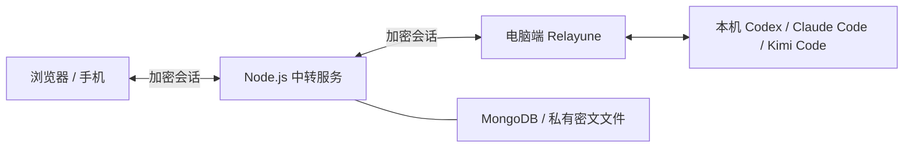

<p align="center">
  
</p>

# Relayune

**随时回到电脑上的 AI 编程任务。**

从手机、平板或浏览器查看 Codex、Claude Code、Kimi Code 的进展，继续对话、处理审批。
Agent 在你电脑上的原项目中执行；Relayune 负责连接设备与转发加密会话。

[官网与下载](https://relayune.giraffetree.cn/#downloads) · [快速开始](#开始使用) ·
[自托管](#自托管) · [文档](docs/README.md) · [English](README.en.md)

[](https://github.com/giraffe-tree/Relayune/actions/workflows/quality.yml)
[](LICENSE)

## 你可以用它做什么

- **接回正在进行的工作**：查看项目、会话历史与实时输出，继续发送消息，按 Agent 支持的能力追加或停止任务。
- **在手机上处理决定**：阅读命令、文件操作和提问的上下文，再允许、拒绝或回答。
- **连接多台电脑**：在同一个客户端中切换电脑与项目，沿用各自的工作目录和 Agent 环境。
- **逐个授权设备**：通过 8 位码或扫码完成独立配对；每个客户端使用独立内容密钥，可单独撤销。
- **选择自己的服务**：使用官方服务，或部署 Node.js + MongoDB 服务端，再在客户端设置服务地址。

重点支持 **Codex、Claude Code、Kimi Code**；其他适配的能力和实验状态见[文档索引](docs/README.md)。
Agent 使用你自己的账户和模型访问权限，Relayune 账户用于连接设备。

## 开始使用

### 下载安装

| 设备 | 获取方式 |
| --- | --- |
| macOS 13+ | [官网下载](https://relayune.giraffetree.cn/#downloads)，提供 Apple 芯片／Intel Universal 安装包，已签名并经 Apple 公证 |
| Android | [官网下载 APK](https://relayune.giraffetree.cn/#downloads)；当前版本尚未完成完整设备旅程验收 |
| iPhone / iPad | [TestFlight 入口](https://testflight.apple.com/join/1smeJNXD)，可安装状态以 TestFlight 页面为准；也可使用 Safari Web 版 |
| 浏览器 | 打开 [Relayune](https://relayune.giraffetree.cn)，登录并连接你的电脑 |
| Windows | 目前提供[源码构建说明](docs/windows-desktop-development.md)，暂不提供公开安装包 |

### 三步连接

1. **准备电脑**：安装并打开 Relayune，登录账户，允许访问项目文件夹；在 Agent 面板确认至少一个 Agent 已安装并登录。
2. **授权客户端**：电脑端点击“连接设备”；手机或浏览器登录同一个服务实例与账户，输入 8 位码，手机 App 也可扫码。
3. **继续任务**：选择电脑、项目和会话，发送消息并处理审批。使用期间保持电脑联网、未休眠且 Relayune 运行。

macOS 登录与客户端授权分开：这一步只把 Mac 绑定到邮箱账户，不会授权承载登录的浏览器访问本机 Agent。
8 位码只用于登录后的客户端授权，不用于 Mac 账户登录；连接码不上传。
Windows 源码版的首次连接流程见平台文档。

手机与电脑不必处于同一 Wi-Fi，但需要能访问同一个 Relayune 服务。
关闭电脑端窗口后可继续在菜单栏运行；退出应用或电脑休眠会中断新的远程操作。

完整步骤、撤销授权与排障见[使用指南](docs/getting-started.md)。

> 当前公开安装包为 **0.3.33**。`main` 包含后续源码修复，安装包和线上服务的版本可能与它不同。
> iOS 已上传 Apple，但 TestFlight 可安装状态未核对；平台实测范围见[发行记录](docs/official-deployment.md)。

## 工作方式



- **电脑端**：在本机调用 Agent，读取会话历史，并为已授权客户端加密输出。
- **服务端**：处理账户、设备发现与密文路由，不持有会话内容密钥。
- **手机与浏览器**：在本地加密输入、解密结果；支持时可协商 WebRTC 直连，失败回退加密中转。

会话正文、历史、附件和审批内容在离开端点前使用 AES-256-GCM 加密。
账户信息、路由元数据和用户主动提交的反馈遵循各自规则；Web 客户端也需要信任网页代码的来源。
协议及保护边界见[端到端加密说明](docs/e2ee-threat-model.md)。

## 从源码开发

需要 **Node.js 22.13+**。Desktop 另需 Rust 与平台工具链，Mobile 另需 Flutter。

```bash
git clone https://github.com/giraffe-tree/Relayune.git
cd Relayune
npm ci
npm ci --prefix desktop
npm run dev
```

`npm run dev` 仅启动 Web 前端。登录、配对与会话功能还需要同源 Node API、MongoDB 和相应配置，
参见[自托管说明](docs/self-hosting.md)。根类型检查包含 Desktop 源码，因此也要安装 Desktop 依赖。

常用检查：

```bash
npm run typecheck
npm run lint
npm test
npm run desktop:check
npm run desktop:test
```

| 组件 | 技术与入口 |
| --- | --- |
| Web | Next.js / TypeScript；`app/` |
| Server | Node.js / MongoDB；`server/` |
| Desktop | Tauri / Rust / TypeScript；[开发说明](desktop/README.md) |
| Mobile | Flutter / Dart；[开发说明](mobile/README.md) |
| Agent 适配与传输 | Node.js；`relay/` |

macOS 贡献者可使用独立应用身份的 [ad-hoc 开发构建](desktop/README.md)，无需维护者的 Developer ID。
完整 Node fixture 以 macOS／Linux 或 WSL 为准；原生 Windows 检查方式见平台文档。

## 自托管

官方服务与自建实例使用同一份源码。客户端可设置自建 HTTPS 服务地址，实例之间隔离登录、配对与本地缓存。

**个人用户名模式**不需要 SMTP：在部署机器上首次设置管理员密码，无通用默认密码。
异地访问使用你自己的 VPN 或公网入口；准备工具可生成 IP／域名证书，客户端仍需明确核对并信任证书。
也可选择邮箱登录模式，配置自己的 SMTP。

安装上面的源码依赖后，构建服务端与静态站点：

```bash
npm run build:self-hosted
```

输出 `dist/self-hosted/` 和 `dist/self-hosted-server/`。接下来需要准备 MongoDB 最小权限账户、
受限环境文件、私有数据目录，以及 Nginx／HTTPS；`npm start` 不会自动读取环境模板。

按[自托管教程](docs/self-hosting.md)完成初始化、客户端连接、升级与恢复。
当前尚未完成从全新机器逐步照教程的独立复现；自建实例核心流程不依赖 Relayune 官方服务，
模型服务仍使用你自行配置的 Agent 账户。

## 文档与社区

- [使用指南](docs/getting-started.md)：安装、登录、配对、任务和排障。
- [文档索引](docs/README.md)：架构、平台开发、Agent 接入和运行维护。
- [路线图](docs/open-source-roadmap.md)：当前范围与后续计划。
- [GitHub Issues](https://github.com/giraffe-tree/Relayune/issues)：问题反馈与功能建议。
- [贡献指南](CONTRIBUTING.md)：贡献范围、验证方式和同许可贡献。
- [安全报告](SECURITY.md)：私密报告漏洞或误泄露凭据，请勿在公开 Issue 发布敏感内容。

项目采用尽力维护，不承诺固定响应时间。提交复现与截图时请使用合成数据；
不要提交生产环境文件、签名私钥、用户数据或本机 Agent 历史。验证范围和剩余公告见
[公开检查记录](docs/publication-checklist.md)与[依赖安全说明](docs/dependency-security.md)。

## 许可

Copyright © 2026 Ernest Chen。项目自有代码和素材采用 [MIT License](LICENSE)，允许依许可使用、修改与商业分发。
第三方组件保留各自许可，见 [THIRD_PARTY_NOTICES.md](THIRD_PARTY_NOTICES.md) 与[许可说明](docs/licensing.md)。
Relayune 名称与 Logo 的品牌使用另见[品牌规则](public/brand/relayune/README.md#品牌使用边界)。
