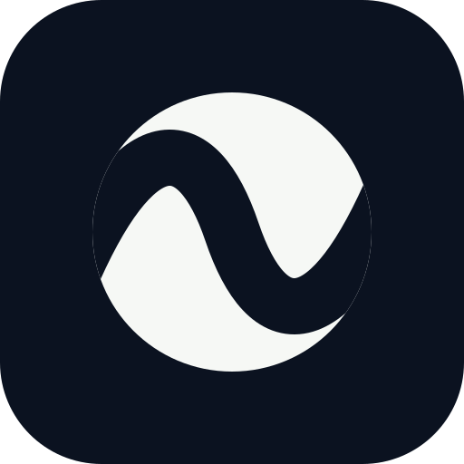

# Relayune 品牌系统：Eclipse Relay

## 1. 正式标志

Relayune 的唯一正式图标是 **Eclipse Relay / 密道月相**：一个完整月盘被开放的
负空间通道分成两个端点。

- 左右月相分别代表浏览器或手机与 Desktop Relay 两个明文端点；
- 负空间通道代表 Server 只路由经过认证的密文，无法看到业务明文；
- 月盘对应名称中的 `lune`，贯穿边缘的通道对应 `relay`；
- 不使用机器人、脑、电路、聊天泡、四角星或其他通用 AI 图形。

标志必须在没有颜色、渐变、阴影和动画时仍然成立。标准色为：

| Token | 色值 | 用途 |
| --- | --- | --- |
| Deep Night | `#0B1220` | 应用底板、通道负空间 |
| Moon White | `#F6F8F5` | 两个月相 |
| Lunar Mint | `#69E1D2` | 只用于动态信号和成功状态 |

## 2. 动效索引

### Flow / 密文流动

文件：`public/brand/relayune/relayune-eclipse-flow.svg`


一枚细小的 Lunar Mint 脉冲沿负空间通道从一端移动到另一端。用于官网主品牌、
Desktop 标题栏和 Flutter `BrandMark`。它表达“经过但不可见的密文”，不表达服务器
持有内容。

规则：周期约 3.4 秒；只动信号，不旋转整枚图标；在 reduced motion 下隐藏脉冲。

### Breathe / 通道呼吸

文件：`public/brand/relayune/relayune-eclipse-breathe.svg`


通道宽度与月盘尺度缓慢呼吸。用于等待、正在建立连接或大尺寸品牌氛围，不用于
16–24px 导航图标，也不同时与 Flow 播放。

规则：周期约 4.8 秒；尺度变化不超过 1.5%；在 reduced motion 下固定为中性静态帧。

### Wait / 月相旋转

文件：`public/brand/relayune/relayune-eclipse-wait.svg`



白色双月相围绕月盘中心旋转，深色底板保持不动。每圈依次经历起步加速、快速释放、
刹车减速、轻微过冲和回弹。外轮廓始终锁定为标准正圆，不做缩放或椭圆形变；动态变化
只发生在内部密道，其宽度和位置滞后外层旋转约 110ms，形成质量不均与拖曳感。
用于无法展示确定进度的短暂等待，例如刷新会话、等待 Desktop 回应或恢复加密连接。

规则：周期约 2.8 秒、顺时针；月盘半径始终为 154，不得非等比缩放；密道宽度在 50–76 之间变化；
不叠加 Lunar Mint 信号；等待结束后立即停止；在 reduced motion 下保留静态母版。
小于 32px 的紧凑控件仍使用普通 CSS 进度指示，不缩放本动效。

### Confirm / 可信闭环

文件：`public/brand/relayune/relayune-eclipse-confirm.svg`


信号完成一次穿越后，Lunar Mint 外环闭合并淡出。用于短码 PAKE 与双向确认均成功
之后的单次反馈。循环文件只用于预览；产品事件中应播放一次并停在静态母版。

规则：先信号、后闭环；不得在确认完成前显示；reduced motion 下只显示低透明静态环。

## 3. 使用方式

Web 默认品牌标志：

```css
.brand-mark {
  background: url("/brand/relayune/relayune-eclipse-flow.svg") center / contain no-repeat;
}
```

小于 24px、列表重复出现或不会持续注视的位置使用
`relayune-eclipse-static.svg`。需要继承文字颜色时内联
`relayune-eclipse-mark.svg`，其 glyph 使用 `currentColor`。

不要：

- 改变通道中心线、月盘比例或开口方向；
- 在母版上添加星点、字母 R、锁头或节点圆点；
- 用渐变、glow 或阴影承担轮廓识别；
- 在同一视图同时循环多个动效；
- 忽略 `prefers-reduced-motion` / Flutter `disableAnimations`。

## 4. 平台映射

| 平台 | 权威源 | 生成或运行位置 |
| --- | --- | --- |
| Web favicon | `public/favicon.svg` | Next metadata `app/layout.tsx` |
| Web 主标 | `relayune-eclipse-flow.svg` | `app/globals.css` |
| Web 小图标 | `relayune-eclipse-static.svg` | pricing、legal、404、比较组件 |
| OG | `relayune-og.svg` | 生成 `public/og.png` |
| Desktop UI | 内联 Eclipse SVG | `desktop/src/main.ts` + `desktop/src/styles.css` |
| macOS/Windows App | `relayune-eclipse-static.svg` | `desktop/scripts/generate-icons.mjs` |
| 菜单栏/托盘 | `relayune-eclipse-template.svg` | `trayTemplate.png` |
| Flutter UI | Eclipse CustomPainter | `mobile/lib/src/widgets/brand_mark.dart` |
| iOS/Android App | `mobile/assets/brand/relayune-app-icon.svg` | `scripts/generate-brand-assets.mjs` |

## 5. 生成、验证与变更纪律

```bash
npm run brand:generate
node --test tests/relayune-brand.test.mjs
npm run desktop:check
npm run desktop:test
npm run mobile:check
```

生成文件包括 Web PNG、iOS AppIcon、Android mipmap、Desktop PNG/ICNS/ICO/托盘模板。
更新几何或颜色时先改 SVG / Flutter painter，再运行生成命令；不得只替换某个平台的
位图。测试会检查正式资源、兼容入口、动效的 reduced-motion 降级、平台引用和透明角。

资源级索引见 [`public/brand/relayune/README.md`](../public/brand/relayune/README.md)，
最初三版方案和选择记录见
[`public/brand/relayune/concepts/README.md`](../public/brand/relayune/concepts/README.md)。
