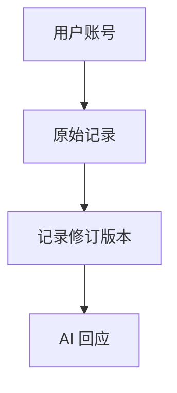

# 消息中的 Mermaid 图表

手机 App 和 Web 会将 `mermaid` 围栏代码块显示为图表。没有语言标记（或标记为
`flowchart`）且正文以 `flowchart TD/TB/BT/LR/RL` 或 `graph` 加方向开头的代码块也会识别。
显式标记其他语言的代码、行内代码保持原样。



手机端在消息输出结束后渲染，首次居中展示完整图表，预览高度随宽高比变化，最高为
320 个逻辑像素。默认上下滑动继续浏览会话；点击“放大操作”后将卡片滚入可见区域、
原地放大，并将手势交给图表，支持单指拖动、双指缩放、加减按钮和“适应全图”。点击“完成”恢复消息
滚动与正文选择复制。图表也可切换源码，或全屏查看；全屏首次同样展示全图。
完整预览优先展示结构，大图细节需放大阅读。Web 端在内容停止变化
350 毫秒后渲染，首次适应容器宽度，可用加减按钮缩放和 Mermaid 按钮查看源码。
语法错误、平台不支持或超出限制时保留源码；当前限制为 20,000 字符、200 条边。
为保持隔离，含配置指令或 YAML 前置配置的图表暂时保留源码。

运行库随客户端分发，不调用外部图表服务。Web 图表运行在无同源权限的 sandbox
iframe 中；手机端在禁止网络的 WebView 中生成 SVG，验证后交给原生 SVG 组件显示。
两端均使用 Mermaid strict 模式、禁用 HTML 标签和外部资源访问。手机端在导出前
将 CSS 主题和自定义颜色写入 SVG 属性，将箭头 marker 展开为普通图形，并将嵌套文本
转换为带明确坐标的文字，避免原生 SVG 组件出现黑色节点、文字偏移和缺失箭头。

运行库版本由 package.json 中的 Mermaid 开发依赖固定。当前采用 Mermaid 11.17.2，
从 ESM 入口与锁定依赖重新打包，实际包含 KaTeX 0.18.2 和 DOMPurify 3.4.17。
不能直接复制 npm 包自带的预构建脚本：上游预构建可能仍内嵌旧依赖，npm override 不会修改其内容。
两端 `BUILD.json` 记录实际参与打包的包版本、锁文件哈希与运行库哈希。
升级后在仓库根目录运行：

```sh
node scripts/sync-mermaid-assets.mjs
python3 scripts/audit-licenses.py --fetch-missing --write-vendored-notices
node scripts/sync-mermaid-assets.mjs --check
node mobile/tool/flutter.mjs test test/ui/mermaid_diagram_test.dart test/ui/incremental_markdown_body_test.dart
PLAYWRIGHT_MODULE=/path/to/playwright/index.mjs node scripts/verify-mermaid-browser.mjs
PLAYWRIGHT_MODULE=/path/to/playwright/index.mjs node scripts/verify-mobile-mermaid-browser.mjs
PLAYWRIGHT_MODULE=/path/to/playwright/index.mjs node scripts/verify-mermaid-security-browser.mjs
```

安全回归使用上游公告的合成输入，检查配置与架构图原型污染、CSS 对相邻元素的影响、
退化 XY 范围和过量 radar ticks 的有界终止，并确认不访问网络；它不等于完整渲染器安全审计。

`mobile/test/fixtures/mermaid/flowchart.svg` 是截图中 11 个中文节点经实际 Mermaid
渲染得到的原生兼容性样本。升级运行库时也需重新检查实际生成的 SVG。
使用 `verify-mobile-mermaid-browser.mjs --update-fixtures` 更新原生样本。
`wide-flowchart-dark.svg` 和 `wide-flowchart-light.svg` 覆盖手机横向流程图的配色
与完整预览回归；合成宽高均超出的图表覆盖消息文字选择区域内的双轴拖动、
双指缩放、适应全图、退出后的会话滚动与复制。按模拟器占用流程取得设备后，
可在隔离的合成消息中运行真实 WebView 导出、Markdown 渲染与原生交互验收（深浅主题）：

```sh
MERMAID_QA_SCREENSHOTS=/tmp/relayune-mermaid-qa node mobile/tool/flutter.mjs drive \
  --driver test_driver/mermaid_diagram.dart \
  --target integration_test/mermaid_diagram_test.dart -d <已独占的模拟器UDID>
```
