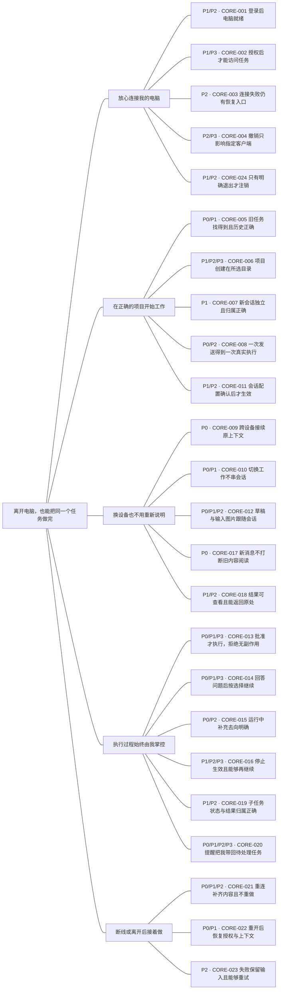
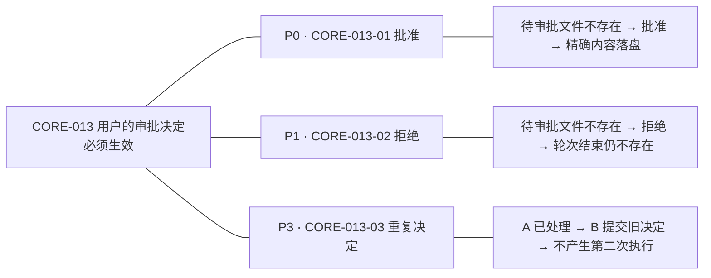

# Relayune 核心使用路径与测试树

**功能分类与 App 点击步骤：**[核心 case 操作手册](core-case-operation-guide.md)。先按功能选范围，再按本页约定执行与记录。

维护日期：2026-09-18。本文是测试设计，执行状态初始为 `not-run`。

**核心价值：离开电脑后，用户仍能安全地推进同一个 Agent 任务，并在回来时接着工作。**

这棵树按“用户目标 → 必须成立的规则”组织；具体可执行叶子在[场景清单](core-user-journey-cases.md)中按“给定 / 当 / 那么”展开。保留原有 `CORE-001`～`CORE-024` 为规则组，新增 `CORE-013-01` 这样的场景编号。规则组不再作为一条大用例整体勾选。

执行时按[共享前置的链路顺序](core-test-execution-order.md)安排，树仍只表示归属。本轮 macOS 专项进度：2026-09-11 简化交互 r1（内部验收档案未随公开源码提供），已修复事件恢复和近期客户端交付优先级，最终签名版986777f已安装，账户入口已真实验证，同步链路待复测；保留首次失败，不作为全树通过。最新执行记录：2026-09-10 核心回归 r3（内部验收档案未随公开源码提供）：62个参数行，45通过、1失败待Web复验、16阻塞、0未执行行，尚未全绿。配对打断、冷恢复沙箱、停止后旧问题、手机子任务审批已修复并完成真实复验；旧审批无终态和Web重复消息有对应自动回归。最终macOS/iOS安装9910ebb；签名版文稿权限保留。浏览器控制、真机通知/扫码、自由输入能力、外部owner排队及严格网络/旧锚点验证继续开放。旧r2（内部验收档案未随公开源码提供）和r1（内部验收档案未随公开源码提供）作为历史证据保留，不混算通过数。

2026-09-21 后续修复：剩余问题与接入边界（内部验收档案未随公开源码提供）。修复目录超时、跨会话提示及轮次计时；Pi 续聊副本、Kimi 自定义答案转新消息已实现。独立原生进程控制及严格原生问题语义仍开放；不改写上一轮矩阵为全通过。

2026-09-20 专项基线：四 Agent × 五条演示旅程（内部验收档案未随公开源码提供）。64个参数行，51通过、2失败、11阻塞、0未执行；P0为37通过/2失败/9阻塞，P1为8通过/1阻塞。Kimi权限与旧问题、缓存历史刷新、Codex原生问题误失效已修复并真实复测；外部CLI控制桥接、Pi外部只读、Kimi自由输入与待确认的设备授权/撤销继续开放。该范围不代表全树回归。

2026-09-12 最新接续：核心回归阶段报告（内部验收档案未随公开源码提供）。截至O112，61/177行通过（Codex29、Claude32、Kimi0），4失败/44阻塞/68未执行。Claude工具图片预览和双会话实时活动状态已修复并在QA iOS页面闭环；Web配对按用户要求暂不复测，历史冲突及长尾同步性能继续跟踪。真实CLI不替代页面验收。

一句话启动：**“跑一轮核心回归。”** 完整要求见[核心回归口令与执行约定](core-regression-prompt.md)，默认执行 P0/P1、计时、修复与复测。

## 固定 P0：所有 Agent 的手机审批与回答

2026-09-20 更新：以下四条对 Codex、Claude Code、Kimi Code、Pi 分别作为独立 P0 核心参数行，默认核心回归必测。具体前置与断言见[场景清单](core-user-journey-cases.md)。

| ID | 场景 | 优先级 |
| --- | --- | --- |
| CORE-013-04 | 目标 Agent 电脑端提交任务 → 手机审批 | P0 |
| CORE-013-05 | 手机新建任务 → 手机审批 | P0 |
| CORE-014-04 | 目标 Agent 电脑端提交任务 → 手机回答 | P0 |
| CORE-014-05 | 手机新建任务 → 手机回答 | P0 |

这是用户指定的固定分级，不因通用新建会话的频率级别降低；其他既有用例分级保持不变。优先级与执行结果分开记录，历史通过不自动代表最新版本通过。

## 所有 Agent 的手机中断与继续

2026-09-19 新增：CORE-015-04/05（P0）分别验证电脑发起/手机新建任务运行中，手机发消息直接中断旧轮再继续；CORE-016-05/06（P1）分别验证两种来源的手机终止。每轮核心回归对每个目标 Agent 分别展开四条独立执行。历史 Codex 专项记录（不代表其他 Agent）：手机中断测试（内部验收档案未随公开源码提供）：四条真实 macOS + QA iOS 场景全部通过（P0 2、P1 2），最终 Relay 修复 9fc8e5b 已签名安装；历史快照竞态与停止后队列不执行问题已闭环。

## 使用优先级：对剩余使用量递进取 80%

本轮按用户定义重新分级，衡量的是**日常使用中发生或经历这些场景的频率**。统计口径先固定为活跃用户的日常任务操作与状态经历；首次连接也计入，但不会因人人都需要首次连接就视为每天的高频动作。

| 级别 | 定义 | 目标使用量占比 | 累计覆盖 |
| --- | --- | --- | --- |
| P0 | 最常用、合计覆盖约 80% 使用量的场景 | 80% | 80% |
| P1 | 剩余 20% 中最常用的约 80% | 16% | 96% |
| P2 | 剩余 4% 中最常用的约 80% | 3.2% | 99.2% |
| P3 | 剩余 0.8% 中最常用的约 80% | 0.64% | 99.84% |
| P4 及以后 | 继续对上一层未覆盖部分取约 80% | P4 为 0.128%，之后依次乘 0.2 | P4 累计 99.968% |

一般式：Pₙ 的目标使用量占比为 `0.8 × 0.2ⁿ`，覆盖到 Pₙ 的累计比例为 `1 − 0.2ⁿ⁺¹`。这是使用量的划分，**不要求 80% 的用例数量被标为 P0，也不表示 80% 的用户必定执行每个 P0 场景**。

当前没有真实使用频率分布，下面按已讨论的日常闭环给出初始判断，不声称已经测得这些比例。暂分到 P3，不为凑满级别新增 P4 场景。

| 当前层级 | 主要场景 | 分级依据 |
| --- | --- | --- |
| P0 | 打开已有会话、读进展与历史、继续输入、跨端接续、保留文字草稿、批准与回答问题、运行中补充、日常重开与重连 | 一次任务中反复发生，构成“找到 → 阅读 → 继续 → 决定 → 再回来”的主循环 |
| P1 | 首次登录配对、新项目/会话、切换模型、附图、预览结果、拒绝操作、主动停止、查看子任务和点击通知 | 启动新工作或主动使用扩展能力时发生，预计是主循环之外最常用的一层 |
| P2 | 一般错误与恢复、权限或附件限制、重复点击、明确退出、撤销客户端 | 条件触发、偶尔处理，不是每轮任务的常态 |
| P3 | 重复审批或答题、迟到事件、创建确认丢失后重试、撤销后重新授权、过期或高风险通知分支 | 多条件组合或较罕见的边界 |

**分级落实到具体叶子和示例参数。** 同一个规则组可以同时包含 P0 的正常路径和 P3 的边界；总树显示该组实际包含的级别，不把整组全部提升到最常用级别。频率与故障影响分别考虑：既有安全与架构约束仍有效，修改相关行为时仍需执行受影响场景，不因它被标为低频而跳过。

本定义适用于本套 `CORE-*` 与 `JNY-*` 使用测试。引用的 MOB、WEB 等专项保留各自既有分级；合并报告时标明“使用优先级”或“专项优先级”，不能直接混排。后续有真实数据时，按固定观察期与用户群统计场景频率、减少重叠计数，再依次选取每层剩余使用量的约 80%；记录依据和日期，更新级别而不更换编号。

## 核心测试树

从左到右读。连线只表示归属；各分支不是依次执行的流水线。节点上的 `P0/P1/P3` 表示该组含这些使用频率级别，实际执行以场景行及示例覆盖值为准；优先级不等于自动化层级。



<details>
<summary>展开示例：审批规则如何长成可独立执行的测试叶子</summary>



三个场景使用独立夹具。拒绝用例失败时，直接定位拒绝分支；不会被一条“审批流程通过”掩盖。

</details>

## 按使用频率执行三条旅程

优先执行 P0 的日常接续与处理决定，再按范围执行 P1 的首次使用旅程。旅程按整体发生频率分级，不取所含场景的最高优先级。每条旅程只走一条代表路径，异常与边界由下方规则场景覆盖。真实页面、真实 Agent 和实际结果共同构成旅程证据。

| 旅程 | 给定 | 当 | 那么 | 覆盖的代表场景 |
| --- | --- | --- | --- | --- |
| JNY-02 · P0 · 离开电脑后继续任务 | 两个客户端已独立授权；电脑 Web 的测试会话已经记住本轮随机标记 | 手机打开同一会话，只问“刚才的标记是什么”，再回电脑 Web 查看 | 手机回复包含原标记；电脑 Web 能看到这次追问及结果，用户无需复制历史 | CORE-005-01、009-01 |
| JNY-03 · P0 · 在手机作出决定并拿到结果 | 手机已授权；测试会话已产生明确写文件审批；新输出文件不存在 | 用户在手机查看精确命令或差异，批准本次操作并等待任务结束 | 目标文件内容与约定完全一致，手机展示对应结果，审批不再可操作 | CORE-013-01 |
| JNY-01 · P1 · 第一次在手机完成任务 | 测试电脑未绑定账户，手机未授权；真实 Agent 已安装且已登录；有可用测试项目 | 用户完成电脑邮箱登录、手机独立授权，在项目内新建会话，发送只读任务 | 手机看到属于该项目的真实回复与完成状态，任务只执行一次 | CORE-001-01、002-01、007-01、008-01 |

`JNY-02/03` 自己建立前置状态，不读取 `JNY-01` 的运行产物。已有登录或授权可由受控夹具准备，但不得绕过产品授权边界。旅程中某一步失败，停止该旅程并记下失败步骤，不继续假定后续成功。**旅程通过只证明表中代表场景与实际执行组合，不代表整个规则组或全部 P0 通过。**

## 用例怎么写才清楚、稳定

用例写法参考的一手资料及采用方式如下；树形与编号方案是本项目的设计判断，递进 80% 的使用优先级来自用户约定，并非资料规定。

| 原则 | 在 Relayune 中怎么写 | 来源 |
| --- | --- | --- |
| 用户目标下面先明确规则，再用实例说明规则；不确定的结果单独记为待澄清 | “审批决定必须生效”下面拆批准、拒绝和重复决定；不把未知能力写成必然成功 | [Cucumber：Example Mapping](https://cucumber.io/blog/bdd/example-mapping-introduction/) |
| 一个场景表达一个行为，使用给定、当、那么；结果必须可观察 | “给定文件不存在且等待审批；当拒绝；那么轮次结束后文件仍不存在” | [Cucumber：Gherkin Reference](https://cucumber.io/docs/gherkin/reference/) |
| 验证用户可见行为；场景隔离；用稳定定位和等待式断言 | 页面改布局不应破坏业务断言；独立目录与会话；等待目标状态，超时报告失败 | [Playwright：Best Practices](https://playwright.dev/docs/best-practices) |
| 端到端测试集中证明少量高价值旅程，细节留在更低成本的层级 | 三条旅程跑真实链路，字段变体、去重和并发时序复用确定性测试 | [Ham Vocke：The Practical Test Pyramid](https://martinfowler.com/articles/practical-test-pyramid.html) |

本项目所说的“优雅”，是**读标题就知道保证什么，失败就能定位，单独重跑不依赖上一次，界面重构不迫使重写业务期望**。具体执行时：

- 标题写“条件或动作 → 结果”，不用“功能正常”“支持审批”等不可判定描述。一个行为可以需要多个相关断言，不机械限制为一个 `assert`。
- 正常、拒绝、超时、恢复等不同结果独立编号。同样规则仅输入不同，可用示例矩阵展开；每个矩阵组合独立记录结果，不在测试里“如果报错就算另一种成功”。
- 页面场景按角色、标签和用户操作定位。不要把函数名、CSS 层级、数据库结构写进用户验收条件；测试文件的实际内容属于可观察的用户产物，可以核对。
- 对模型输出核对随机标记、选择结果、文件内容等稳定事实，不精确匹配整段自然语言。批准按钮变灰或模型说“写好了”都不足以证明操作成功。
- 等待具体会话的目标事件或可见状态，并设上限；不以固定等待几秒代替断言。拒绝等“没有发生”的结果需等到对应轮次终态后再检查；重复执行需同时核对操作次数，不能仅看最终文件相同。
- 先写会失败的回归，再修复。真实 CLI 未按要求产生审批时，该审批用例没有被验证；保留证据并按环境、模型行为、适配器或未知原因分类，不伪造成功。

可复用写法：

```text
编号：CORE-013-02
标题：拒绝写文件后，该文件不会被创建
规则 / 使用优先级：CORE-013 / P1
给定：独立测试会话正在等待写入 result.txt 的审批，文件尚不存在
当：用户拒绝这一次写入
那么：本轮结束后 result.txt 仍不存在，审批不可再提交
证据：脱敏审批卡、关联本轮的终态、测试目录文件检查
隔离：只使用本轮目录与会话；不依赖批准场景先运行
```

详细的可执行场景及示例矩阵见[场景清单](core-user-journey-cases.md)。这里使用 Gherkin 的表达方式，不新增 Cucumber 框架或假定已有自动化实现。

## 按使用频率安排顺序，按改动确定范围

日常基线先执行 JNY-02、JNY-03 与本轮适用的 P0 叶子，再依次补 P1、P2、P3。完整建档时执行三条旅程和声明范围内全部适用叶子；局部改动必须纳入直接受影响的叶子，无论其频率级别。每条用例仍按最合适的协议、真实 CLI 或页面层级取证。

| 变化或目的 | 选择范围 | 证据层级 |
| --- | --- | --- |
| 日常高频基线 | JNY-02、JNY-03 + 声明组合内适用的 P0 叶子 | 优先证明阅读、接续、决定和恢复的主循环 |
| 首次完整建档 | 三条旅程 + 声明组合内全部适用叶子，按 P0 → P1 → P2 → P3 执行 | 各级单独报告覆盖，不能以 P0 通过代表低频分支通过 |
| 登录、客户端授权、退出 | JNY-01 + CORE-001～004、024 | 页面恢复路径 + 授权隔离与撤销的协议证据 |
| 发送、会话、跨端或历史 | JNY-02 + CORE-005、007～010、012、017、021～023 的受影响叶子 | 页面连续性 + 真实上下文回读 + 并发、去重夹具 |
| 审批、提问、运行控制 | JNY-03 + CORE-013～016、019～020 的受影响叶子 | 真审批及精确副作用 + 迟到事件和归属的确定性回归 |
| Agent 接入或 CLI 升级 | 三条旅程中受影响部分 + 该 Agent 的会话、审批、停止、恢复场景 | 真实 CLI 不能被假协议替代；先合约回归，再真实复验 |
| 单一局部 UI 改动 | 对应叶子及直接相邻交互 | 首选页面或组件验证；不自动重跑全部真实模型流程 |

平台、Agent、输入方式属于执行维度，不在树上复制三套同名分支。基础路径先记录一个明确组合；共享协议或跨端修改扩大受影响组合。**一个 Agent 的通过不能推断其他 Agent；模拟器结果不能替代真机通知、后台和权限行为。**

## 记录、维护与边界

记录放在 `docs/qa/runs/YYYY-MM-DD-core-user-journeys.md`，实际运行时创建。先声明本轮选中的“场景 × 示例参数 × 平台 × Agent × 验证层级”，再执行；不能测试结束后删去失败组合。

| 场景 / 旅程 | 使用优先级 | 示例参数 | 电脑 / 客户端 / Agent | 层级 | 状态 | 实际结果与证据 |
| --- | --- | --- | --- | --- | --- | --- |
| CORE-013-02 | P1 | 拒绝新文件写入 | macOS / Android 真机 / Kimi Code | 真实页面 + CLI + 文件核对 | not-run | 待执行 |

记录元信息包含 Git 提交、应用构建、系统与客户端版本、实际 CLI 路径及版本、测试条件、超时上限。每行使用 `not-run`、`passed`、`failed`、`blocked` 或 `not-applicable`；后两者写明依据。失败保留首次结果和证据，修复重跑另记，不通过反复重试抹掉问题。

- 未安装、未登录、无额度或无设备属于阻塞；当前版本明确不支持某能力可记不适用，但要验证入口隐藏或限制明确。已声明支持却失败不能降为不适用。
- 手机挂起/终止后的可靠通知、所有 Agent 的同一种排队方式、任意本机文件预览，不是当前统一承诺。执行前按 [Mobile 边界](../../mobile/README.md)和实际能力固定期望。
- 保留 `CORE-NNN` 原有范围；新场景在对应组下追加 `-NN` 并独立判断使用频率，改名或调整级别不换号，废弃保留 `retired` 说明。场景清单是详细期望的维护来源，主树只保留简短规则及子项级别汇总。
- 执行报告分别汇总 P0、P1、P2、P3 的结果，保留当时分级版本；用例数量覆盖率不能写成用户使用量覆盖率。
- 规则组只有在声明范围内全部适用叶子通过后才能汇总为通过；报告同时列出未执行、阻塞和不适用数量。单一叶子或旅程成功不自动提升父节点状态。
- 测试只使用独立生成的数据和目录；证据不得包含真实用户会话、密码、Cookie、授权令牌、连接码或密钥。撤销不能擦除客户端已经读取的内容。未知产品行为登记为待澄清，不现场放宽判定。
- 本树是维护入口，执行结果以运行档案为准。原 P0/P1 轮次（内部验收档案未随公开源码提供）；最新补测：三条原 blocked 的真实页面与操作计时，2 通过、1 失败（内部验收档案未随公开源码提供）。`npm run test:mobile-map` 仍只检查移动专项，不能证明本树已覆盖或已通过。

## 专项入口

| 规则范围 | 深入验证 |
| --- | --- |
| CORE-001～004、024 | [Desktop 旅程](../desktop-user-journey-qa.md)、[Web 账户测试树](web-sidebar-account-test-tree.md)、[架构与安全约束](../security-and-architecture.md) |
| 会话、执行、审批、恢复 | [Agent 接入测试经验](agent-integration-testing-lessons.md)、[真实 CLI 历史记录](../agent-live-verification.md)、[Kimi 合约测试集](kimi-code-contract-testset.md) |
| 原生手机分支 | [移动专项导图](mobile-experience-test-mindmap.md)、[移动执行清单](../../tests/cases/mobile-experience.json)、[Mobile 功能边界](../../mobile/README.md) |
| 阅读、加载、恢复耗时 | [性能复测档案](../performance/README.md)，复用真实测量口径，不凭感觉写“流畅” |
| Windows 电脑 | [Windows 专项](../windows-desktop-development.md)，macOS 登录路径和结果不能替代 Windows |

反馈、安装升级和发布保留各自专项；影响核心任务访问时，选择本树对应规则复测。

2026-09-12 Claude 页面接续：14行通过，全轮44/177行通过；主动停止显示问题5f19de0已修复并安装，锁屏阻塞页面复测。详见阶段报告（内部验收档案未随公开源码提供）。

2026-09-12 解锁后接续：F08停止显示、F09子任务历史恢复均已真实页面闭环；Claude15行通过，全轮45/177行通过，见上述阶段报告。
