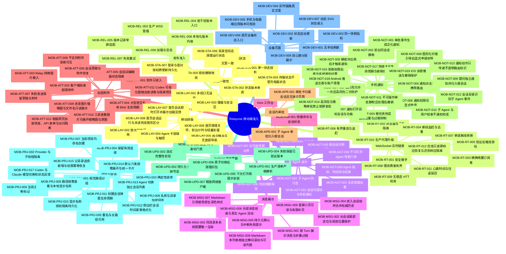

# Relayune 移动端体验测试思维导图

跨端用户主线与核心用例总入口见[核心使用路径与测试树](core-user-journeys.md)；本文继续维护移动端专项细节。

这份图是移动端体验准入的需求主视图；执行状态与自动化证据维护在
[`tests/cases/mobile-experience.json`](../../tests/cases/mobile-experience.json)。用例 ID 永不复用，
需求改名不改 ID，废弃用例在执行清单中标记 `retired`。

## 执行规则

- `npm run test:mobile-map` 校验图与执行清单严格一致，并核对自动化测试标题。
- 每个测试标题使用 `[MOB-AREA-NNN][platform]`，同一用例可有 Web、Server、Flutter 多个平台证据。
- 日常开发允许 `planned`；最终发布运行 `npm run test:mobile-map:release`，P0/P1 不得仍为 `planned`。
- 人工用例只允许 P1/P2，必须记录证据文件与日期；P0 必须自动化。
